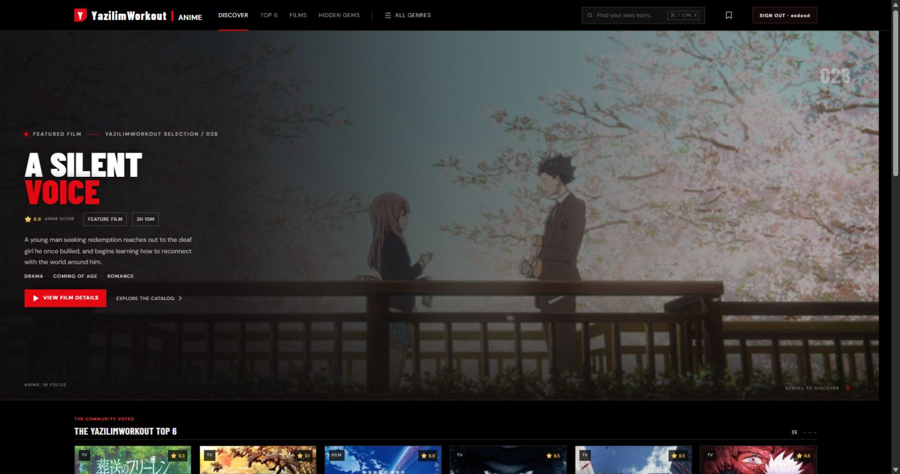

<div align="center">
  <h1>YazilimWorkout | Anime</h1>
  <p>A curated anime discovery experience for finding your next favorite series or film.</p>
  <p>
    
    
    
    
    
  </p>
</div>

<p align="center">
  
</p>

## About

YazilimWorkout | Anime is a dark, cinematic catalog for browsing anime series and films. The homepage puts a featured title up front, then guides visitors through community rankings, new episodes, recommendations, hidden gems, and themed collections. Search and genre filters make it easy to narrow down the catalog, while each title can be opened for more details.

The project is built as a responsive single-page experience with React and Vite. Sign-in and registration currently use browser local storage, so accounts are for demonstration and remain on the current device.

## Features

- Featured anime and film presentations with title details and genre information
- Searchable catalog with genre filtering
- Ranked anime cards and curated discovery sections
- Title details modal with related trailer area
- Sign-in and registration screens with a profile menu and sign-out
- Responsive layout for desktop and smaller screens
- Loading states for catalog content

## Getting started

Use Node.js and npm, then run:

```bash
npm install
npm run dev
```

Vite prints the local address when the development server is ready.

## Production build

```bash
npm run build
npm run preview
```

## Tech stack

- React for the user interface
- Vite for development and production builds
- Tailwind CSS for utility styling
- TanStack Query for asynchronous data state
- Lucide React for interface icons

## Authentication note

Authentication is a front-end demo. User details are stored in the browser's local storage; there is no server-side account system yet. Avoid using real passwords or sensitive information.
